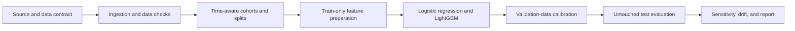

# Credit Default Modeling & Validation

A reproducible research project to estimate borrower default probabilities and evaluate their reliability.

**Foundation/scaffolding complete; modeling and empirical validation are planned.**

No dataset, default definition, or prediction horizon has been selected. No model
has been fitted and no performance results are available.

## Problem and research questions

Credit risk analysis needs useful rankings of borrower risk and probabilities that
match observed default frequencies. This project will investigate whether an
interpretable logistic regression baseline is reliable, whether a nonlinear
LightGBM challenger adds value, and how calibration and performance change over
time and under reasonable changes in assumptions.

The validation component is a **separate evaluation workflow** within this
self-developed project; it does not provide organizationally independent validation.

## Planned architecture

Every pipeline stage below is planned. The working foundation currently validates
configuration only.



## What exists

| Area | Implemented today | Planned |
| --- | --- | --- |
| Engineering | Installable `src/` package, CLI help, strict YAML validation | Data and experiment workflows |
| Quality | Ruff, pytest, generated `uv.lock`, GitHub Actions checks | Pipeline and empirical regression tests |
| Data | Proposed contract and local-data ignore rules | Dataset selection, ingestion, DuckDB and SQL |
| Modeling | Design documentation | Logistic regression, LightGBM, calibration |
| Evaluation | Validation plan and report template | Discrimination, probability quality, temporal stability, sensitivity and drift |

## Technology choices

- **Python 3.11+ and `src/` layout:** explicit packaging and reusable, testable code.
- **uv and `pyproject.toml`:** dependency groups and a generated reproducible lockfile.
- **PyYAML and Pydantic:** safe YAML loading and strict, readable schema validation.
- **Ruff, pytest, GitHub Actions:** formatting, static checks, and automated behavioral tests.
- **DuckDB and SQL (planned):** local analytical queries without a database service.
- **pandas, NumPy, scikit-learn, LightGBM (planned):** tabular preparation, baseline,
  challenger, and calibration. Matplotlib and seaborn are planned for figures.

The `modeling`, `analytics`, and `visualization` extras are optional, resolved in the
lockfile, and not installed or runtime-tested for this foundation. Their presence
is not an implemented modeling workflow.

## Quickstart

Requires Git and [uv](https://docs.astral.sh/uv/getting-started/installation/).
Run from the repository root; `uv sync` uses `.python-version` (3.11), downloading
Python if needed. These are implemented commands:

```bash
git clone https://github.com/kritinkaul/credit-risk-validation.git
cd credit-risk-validation
uv sync --locked
uv run python -c "import credit_risk; print(credit_risk.__version__)"
uv run credit-risk --help
uv run python -m credit_risk --help
uv run credit-risk validate-config configs/base.yaml
uv run ruff check .
uv run ruff format --check .
uv run pytest
```

Validation exits `0` for a valid foundation config, `1` for invalid/unreadable YAML,
and `2` for CLI usage errors. Explicit `null` dataset/target fields and a `pending`
split are allowed because research choices remain open. Missing keys, unexpected
keys, invalid types, unsupported values, and duplicate YAML keys are rejected.
A valid config establishes neither data quality nor experiment readiness. The
command reads no dataset and creates no database. There are no train/evaluate commands.

## Repository map

| Path | Purpose |
| --- | --- |
| `src/credit_risk/` | Working CLI and configuration schema |
| `configs/base.yaml` | Foundation configuration with unresolved research fields |
| `tests/` | Configuration, CLI, and documentation-link tests |
| `docs/` | Architecture, methodology, proposed data contract, validation plan and decisions |
| `sql/`, `data/`, `notebooks/` | Guidance for future local analytical work |
| `reports/templates/` | Unfilled model-validation report |
| `.github/` | CI and contribution templates |

Future `data`, `features`, `models`, `validation`, and `reporting` Python modules
will be added when they contain working behavior; empty placeholder packages are omitted.

## Planned evaluation

Define the prediction timestamp, default event, outcome horizon, and label maturity
before modeling. Where dates permit, use chronological training, validation and
calibration, and untouched test cohorts, with borrower dependence and overlapping
outcome windows handled explicitly. Fit preprocessing only on training partitions.
If usable dates are absent, disclose that limitation and do not claim out-of-time validation.

Compare ROC-AUC and PR-AUC (with a specified integration convention) for ranking;
Brier score, log loss, and calibration plots for probability quality. Report event
prevalence and uncertainty, not accuracy alone. Examine temporal slices, sensitivity
to assumptions, and feature drift without treating drift as proof of deterioration.
No arbitrary success metrics or universal PSI cutoffs are prescribed.

Read the [methodology](docs/methodology.md), [architecture](docs/architecture.md),
[validation plan](docs/validation_plan.md), and milestone [roadmap](docs/roadmap.md).
See [contributing](CONTRIBUTING.md) for development guidance.

## Limitations and responsible use

Educational research, **not a lending decision system**. Dataset suitability,
representativeness, fairness, licensing, and empirical performance remain unassessed.
Explainability does not establish causality. The project is neither production-ready
nor a claim of regulatory compliance. Fraud detection, survival analysis, LLM
assistants, APIs, and deployment implementation are outside the initial scope.

Original code is covered by the [MIT license](LICENSE). Future datasets retain their
own licenses and must not be redistributed without permission. Do not commit raw
borrower data, private information, credentials, models, or generated reports.
